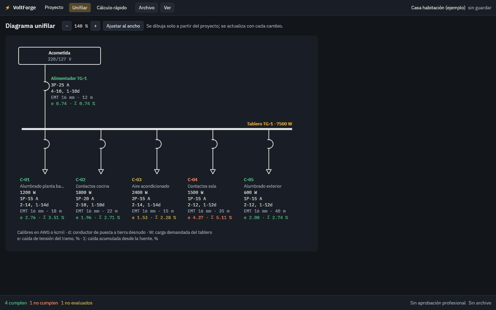
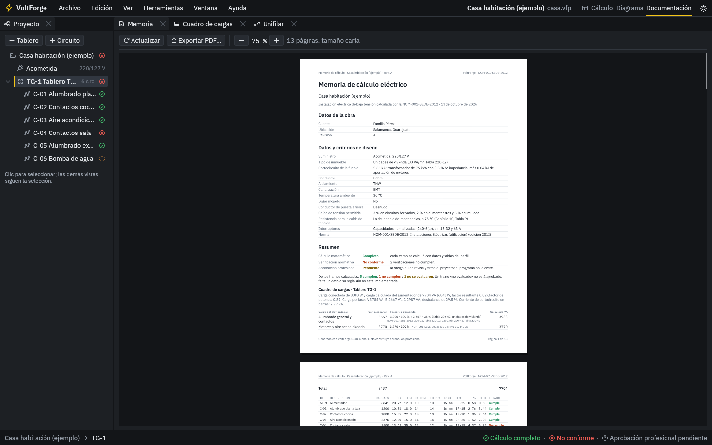

# VoltForge

Cálculo de instalaciones eléctricas de baja tensión, de código abierto.

VoltForge modela una instalación una sola vez y de ese modelo deriva los
cálculos, el cuadro de cargas, el diagrama unifilar y la memoria de cálculo.
El perfil normativo inicial es la NOM-001-SEDE-2012.

> **Estado: alfa.** Hay motor de cálculo, aplicación de escritorio con
> instalador para Windows, línea de comandos, unifilar y memoria en PDF. Los
> casos de referencia aún no los revisa un ingeniero. Ver
> [`docs/roadmap.md`](docs/roadmap.md).

## Qué funciona hoy

| Cálculo | Detalle |
| --- | --- |
| Corriente nominal | Una, dos y tres fases, a partir de potencia y factor de potencia |
| Corriente de diseño | 125 % de la carga continua más 100 % de la no continua |
| Caída de tensión | Por impedancia con la Tabla 9, conductores en paralelo, ajuste opcional de resistencia por temperatura y comprobación con la fórmula exacta |
| Longitud máxima | Longitud con la que un tramo cumple un límite de caída |
| Conductor | Menor calibre que cumple terminales, temperatura ambiente, agrupamiento, protección y, si se pide, un límite de caída de tensión; indica qué criterio lo determinó |
| Interruptor | Capacidad normalizada inmediata superior a la corriente de diseño, o el que fije el usuario, verificado |
| Motores | Corriente por las tablas 430-248 y 430-250, conductor al 125 %, interruptor por la Tabla 430-52, relevador de sobrecarga y alimentadores con el 25 % del motor mayor (430-24) |
| Carga del alimentador | Artículo 220: tipo de inmueble y áreas de cada tablero, carga mínima de alumbrado por m² (Tabla 220-12), 180 VA por salida de contacto, factores de demanda de alumbrado (220-42), contactos (220-44), aparatos fijos de vivienda (220-53) y equipo de cocina (220-56), con el detalle de cada grupo |
| Aire acondicionado | Con la ampacidad mínima y la protección máxima de la placa, o con la corriente de carga nominal del compresor (artículo 440) |
| Cortocircuito | Corriente de falla en cada tablero por el método de impedancias, desde el dato de la compañía o el transformador, con aportación de motores; capacidad interruptiva de cada interruptor (110-9) |
| Puesta a tierra | Tabla 250-122, con el incremento proporcional cuando el conductor de fase se sobredimensiona |
| Tubería conduit | EMT, IMC, RMC y PVC cédula 40 y 80; ocupación de 53, 31 y 40 % según el número de conductores, niples al 60 % y verificación de atascamiento |

| Proyecto | Fuente, tableros y subtableros, circuitos y cargas en un archivo JSON |
| Cuadro de cargas | Cada circuito y alimentador con su estado, carga por fase, desbalance y caída de tensión acumulada desde la fuente |
| Interfaz gráfica | Paneles acoplables y espacios de trabajo (Cálculo, Diagrama, Documentación); navegador del proyecto; cuadro de cargas con filtros y columnas configurables; propiedades separadas en Datos, Resultados y Normativa; vista previa de la memoria. Recalcula con cada cambio y recuerda el acomodo |
| Procedimiento | Cada circuito y alimentador del proyecto muestra su procedimiento paso a paso: fórmula, valores sustituidos y la tabla o artículo de la norma |
| Diagrama unifilar | Se dibuja solo a partir del proyecto: fuente, alimentadores, tableros, subtableros y circuitos con interruptor, conductores, tubería y caída de tensión. En la pestaña Unifilar y en la memoria |
| Excel | El cuadro de cargas se exporta a un libro con tableros, circuitos y resultados, y se importa de vuelta: agrega o actualiza por ID, informa las filas con errores y se puede deshacer. Desde el menú Archivo o con `voltforge excel` y `voltforge importar` |
| Memoria de cálculo | PDF con datos de la obra (cliente, ubicación, revisión, responsable y cédula), datos y criterios, cuadro de cargas, diagrama unifilar, observaciones, el procedimiento de cada tramo y espacio para firmas; también la hoja de un cálculo rápido. Desde el menú Archivo o con `voltforge memoria` |
| Cálculo rápido | Un solo circuito, sin proyecto: corriente nominal y de diseño, interruptor, verificación del conductor, puesta a tierra, tubería y caída de tensión; fórmula y procedimiento con los valores sustituidos, comprobación exacta y, si no cumple, alternativas ya calculadas (calibre mayor, conductores en paralelo, longitud máxima) que se aplican con un clic |






Cada elemento queda como **cumple**, **no cumple** o **no evaluado**. 

Lo siguiente en el plan está en [docs/roadmap.md](docs/roadmap.md).

## Probarlo

Requiere [Rust](https://rustup.rs) 1.95 o posterior (1.80 basta para el
motor de cálculo).

```
cargo test                                     # ejecuta los casos de referencia
cargo run -p voltforge-cli -- ejemplo casa.vfp   # escribe un proyecto de ejemplo
cargo run -p voltforge-cli -- calcular casa.vfp  # muestra su cuadro de cargas
cargo run -p voltforge-cli -- memoria casa.vfp   # escribe casa.pdf, la memoria de cálculo
cargo run -p voltforge-app -- casa.vfp           # abre la interfaz gráfica
```

Sin instalar Rust: en la página *Releases* del repositorio está el instalador
de Windows de cada versión. Además, cada compilación publica los ejecutables
`voltforge` (línea de comandos) y `voltforge-app` (interfaz gráfica) para
Windows y Linux, y el instalador, en la pestaña *Actions*, dentro de la
ejecución más reciente, en la sección *Artifacts*.

Los proyectos se guardan con la extensión `.vfp`. Por dentro son JSON
legible; también se pueden abrir archivos `.json` de versiones anteriores.

## Organización

```
crates/voltforge-core/         tipos, unidades, errores y validación; sin dependencias obligatorias
crates/voltforge-rules/        perfiles normativos: tablas, parámetros y referencias
crates/voltforge-electrical/   fórmulas: corriente, caída, conductor, protección, tierra, tubería
crates/voltforge-project/      proyecto, cuadro de cargas, procedimiento, cálculo rápido, veredicto
crates/voltforge-diagrams/     diagrama unifilar
crates/voltforge-reports/      memoria de cálculo en PDF (Typst)
crates/voltforge-cli/          línea de comandos
crates/voltforge-app/          aplicación de escritorio (egui)
data/nom-001-sede-2012/        tablas, parámetros y cláusulas de la norma en CSV
fixtures/engineering-cases/    casos de referencia en CSV, revisables por un ingeniero
docs/                          arquitectura, metodología, fuentes normativas y decisiones
assets/fonts/                  tipografía IBM Plex de la interfaz y de la memoria
tools/                         extracción y validación de las tablas desde el texto de la norma
```

Detalles en [`docs/architecture.md`](docs/architecture.md). Para contribuir,
[`CONTRIBUTING.md`](CONTRIBUTING.md).

El motor no depende de ninguna interfaz, calcula con precisión completa y no
redondea pasos intermedios. Cuando una tabla no cubre un caso, devuelve un
error que explica qué falta en lugar de suponer un valor.

## Verificación

- Las tablas se validan por consistencia interna y se cotejaron contra una
  captura independiente. Ver [`data/nom-001-sede-2012/README.md`](data/nom-001-sede-2012/README.md).
- Cada cálculo tiene pruebas matemáticas, de referencia y normativas, y los
  casos de [`fixtures/engineering-cases/`](fixtures/engineering-cases/) se
  pueden revisar en una hoja de cálculo. Ver
  [`docs/engineering-methodology.md`](docs/engineering-methodology.md).
- Cada paso del procedimiento cita la cláusula de la norma; en el repositorio
  no hay texto de normas. Ver [`docs/normative-sources.md`](docs/normative-sources.md).
- El programa separa cálculo, verificación normativa y aprobación
  profesional, y nunca da la tercera.

## Responsabilidad profesional

VoltForge asiste el cálculo; no sustituye el criterio ni la firma de un
ingeniero. El programa distingue entre un cálculo matemático, una comprobación
normativa y una aprobación profesional, y esta última siempre es de quien
firma el proyecto. Las tablas incluidas son una transcripción de trabajo: la
fuente con validez oficial es la norma publicada en el Diario Oficial de la
Federación.

## Agradecimientos

Al Ing. Juan Carlos Vega Mendoza, cuyas hojas de cálculo de caída de tensión y
de tubería sirvieron como referencia de lógica y como casos de prueba.

## Licencia

Doble licencia, a tu elección: [MIT](LICENSE-MIT) o [Apache-2.0](LICENSE-APACHE).
