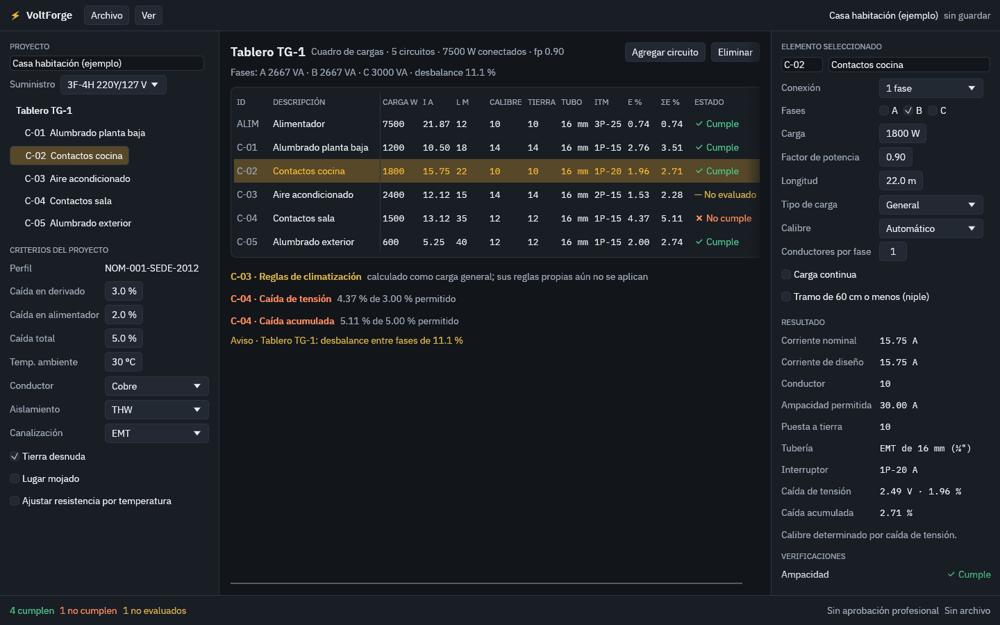
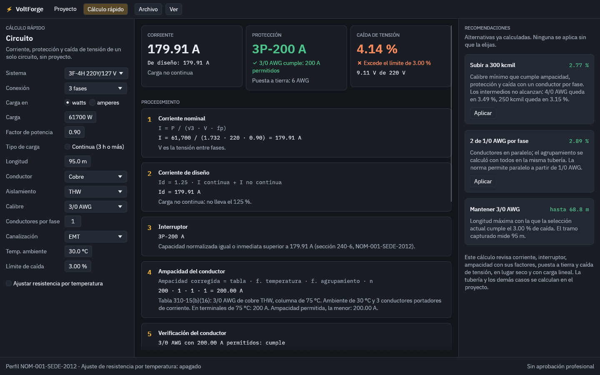

# VoltForge

Cálculo de instalaciones eléctricas de baja tensión, de código abierto.

VoltForge modela una instalación una sola vez y de ese modelo deriva los
cálculos, el cuadro de cargas, el diagrama unifilar y la memoria de cálculo.
El perfil normativo inicial es la NOM-001-SEDE-2012.

> **Estado: desarrollo temprano.** Hoy existen el motor de cálculo, el modelo
> del proyecto y una línea de comandos. Ya hay una primera interfaz gráfica; todavía no
> hay instalador.

## Qué funciona hoy

| Cálculo | Detalle |
| --- | --- |
| Corriente nominal | Una, dos y tres fases, a partir de potencia y factor de potencia |
| Corriente de diseño | 125 % de la carga continua más 100 % de la no continua |
| Caída de tensión | Por impedancia con la Tabla 9, conductores en paralelo, ajuste opcional de resistencia por temperatura y comprobación con la fórmula exacta |
| Longitud máxima | Longitud con la que un tramo cumple un límite de caída |
| Conductor | Menor calibre que cumple terminales, temperatura ambiente, agrupamiento, protección y, si se pide, un límite de caída de tensión; indica qué criterio lo determinó |
| Interruptor | Capacidad normalizada inmediata superior a la corriente de diseño |
| Puesta a tierra | Tabla 250-122, con el incremento proporcional cuando el conductor de fase se sobredimensiona |
| Tubería conduit | EMT, IMC, RMC y PVC cédula 40 y 80; ocupación de 53, 31 y 40 % según el número de conductores, niples al 60 % y verificación de atascamiento |

| Proyecto | Fuente, tableros y subtableros, circuitos y cargas en un archivo JSON |
| Cuadro de cargas | Cada circuito y alimentador con su estado, carga por fase, desbalance y caída de tensión acumulada desde la fuente |
| Interfaz gráfica | Pantalla principal: árbol del proyecto, criterios, cuadro de cargas y detalle editable del elemento seleccionado; recalcula con cada cambio. Tema oscuro o claro y color de acento a elegir |
| Procedimiento | Cada circuito y alimentador del proyecto muestra su procedimiento paso a paso: fórmula, valores sustituidos y la tabla o artículo de la norma |
| Memoria de cálculo | PDF con datos y criterios, cuadro de cargas, observaciones, el procedimiento de cada tramo y espacio para firmas; también la hoja de un cálculo rápido. Desde el menú Archivo o con `voltforge memoria` |
| Cálculo rápido | Un solo circuito, sin proyecto: corriente nominal y de diseño, interruptor, verificación del conductor, puesta a tierra, tubería y caída de tensión; fórmula y procedimiento con los valores sustituidos, comprobación exacta y, si no cumple, alternativas ya calculadas (calibre mayor, conductores en paralelo, longitud máxima) que se aplican con un clic |





Cada elemento queda como **cumple**, **no cumple** o **no evaluado**. Los
motores y equipos de aire acondicionado se calculan como carga general y
quedan sin evaluar, porque sus reglas propias aún no están implementadas.

Lo siguiente en el plan: diagrama unifilar e instalador de Windows.

## Probarlo

Requiere [Rust](https://rustup.rs) 1.95 o posterior (1.80 basta para el
motor de cálculo).

```
cargo test                                     # ejecuta los casos de referencia
cargo run -p voltforge-cli -- ejemplo casa.json   # escribe un proyecto de ejemplo
cargo run -p voltforge-cli -- calcular casa.json  # muestra su cuadro de cargas
cargo run -p voltforge-cli -- memoria casa.json   # escribe casa.pdf, la memoria de cálculo
cargo run -p voltforge-app -- casa.json           # abre la interfaz gráfica
```

Sin instalar Rust: cada compilación publica los ejecutables `voltforge` (línea de
comandos) y `voltforge-app` (interfaz gráfica) para Windows y Linux en la pestaña *Actions* del repositorio, dentro de la
ejecución más reciente, en la sección *Artifacts*.

## Organización

```
crates/voltforge-core/     motor de cálculo, sin dependencias obligatorias
crates/voltforge-project/  modelo del proyecto y cuadro de cargas
crates/voltforge-cli/      línea de comandos
crates/voltforge-report/   memoria de cálculo en PDF (Typst)
crates/voltforge-app/      interfaz gráfica de escritorio (egui)
assets/fonts/              tipografía IBM Plex de la interfaz y de la memoria
data/nom-001-sede-2012/    tablas de la norma en CSV, revisables en una hoja de cálculo
tools/                     extracción y validación de las tablas desde el texto de la norma
```

El motor no depende de ninguna interfaz, calcula con precisión completa y no
redondea pasos intermedios. Cuando una tabla no cubre un caso, devuelve un
error que explica qué falta en lugar de suponer un valor.

## Verificación

- Las tablas se validan por consistencia interna y se cotejaron contra una
  captura independiente. Ver [`data/nom-001-sede-2012/README.md`](data/nom-001-sede-2012/README.md).
- Cada cálculo tiene casos de prueba con resultado conocido en
  [`crates/voltforge-core/tests/`](crates/voltforge-core/tests/).

## Responsabilidad profesional

VoltForge asiste el cálculo; no sustituye el criterio ni la firma de un
ingeniero. El programa distingue entre un cálculo matemático, una comprobación
normativa y una aprobación profesional, y esta última siempre es de quien
firma el proyecto. Las tablas incluidas son una transcripción de trabajo: la
fuente con validez oficial es la norma publicada en el Diario Oficial de la
Federación.

## Agradecimientos

Al Ing. Juan Carlos Vega Mendoza, cuyas hojas de cálculo de caída de tensión y
de tubería sirvieron como referencia de lógica y como casos de prueba.

## Licencia

Doble licencia, a tu elección: [MIT](LICENSE-MIT) o [Apache-2.0](LICENSE-APACHE).
